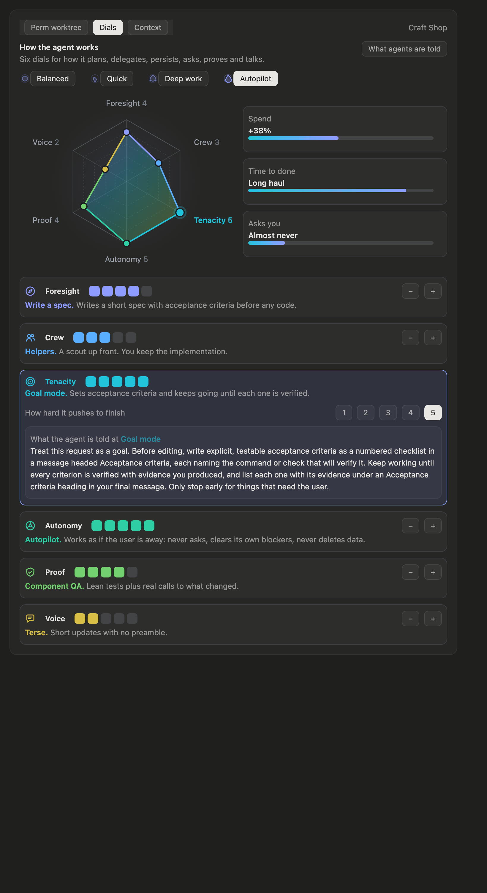
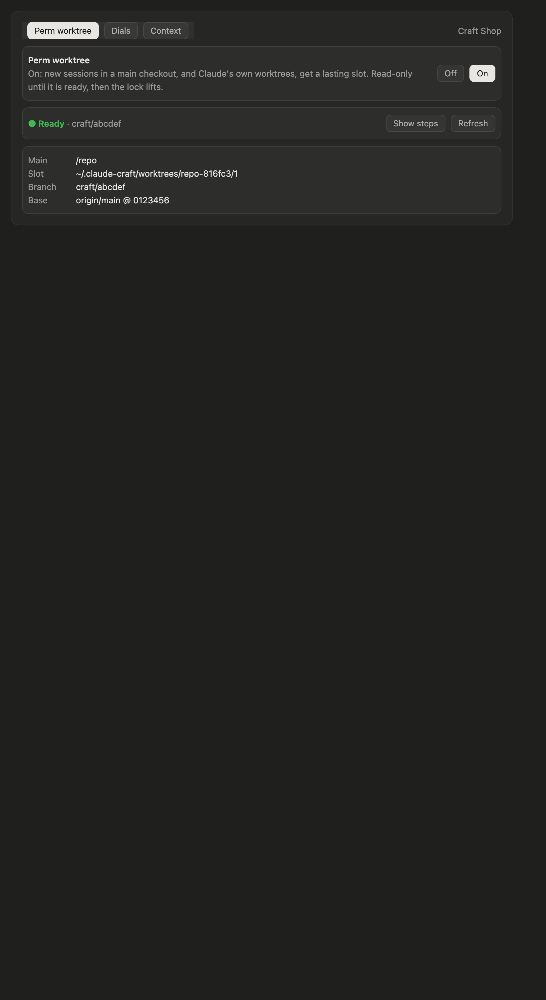
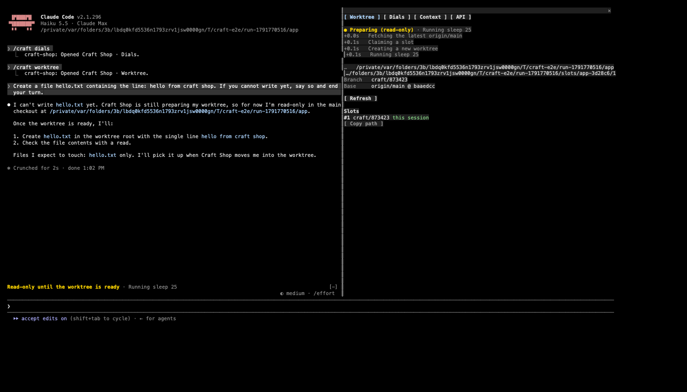
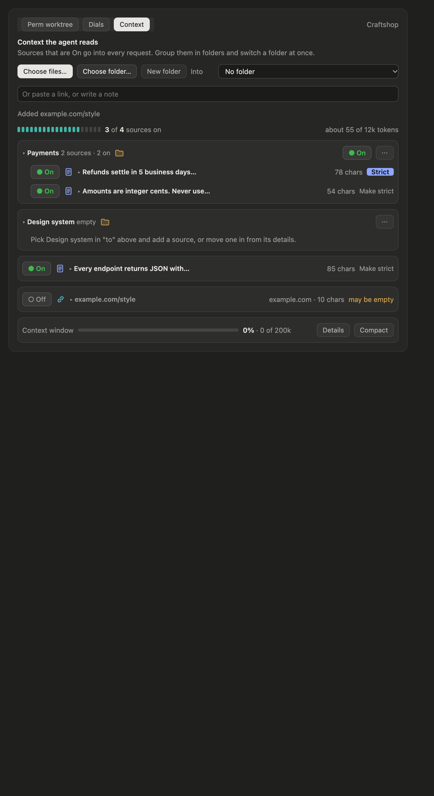

# Claude Craftshop

A Claude Code mod that adds a **Craftshop** pane with three tabs (**Perm worktree · Dials · Context**). It brings three CommissionAI features into Claude Code:

1. **Perm worktree with a read-only head start.** When it is on, each new session claims a lasting worktree slot. The agent reads, searches and plans while the slot is prepared, then the session moves in and the lock lifts. It is off by default.
2. **Crew dials.** Six dials set how the agent works: Foresight, Crew, Tenacity, Autonomy, Proof and Voice.
3. **Context.** A library of notes, links and files you share with the agent, each switched On or Off.



## Install

At the prompt of a Claude Code terminal session (2.1.296 or newer):

```
/plugin install craft-shop --marketplace patrick-lai/claude-craft-shop
```

Answer `y` to add the marketplace, then pick a scope (user scope is first). Next you get a screen of options. The defaults work as they are.

Open the pane with `/craft`, or `/craft worktree|dials|context` to go straight to a tab. The pane opens by itself where the surface docks panes: the desktop app, and the terminal's fullscreen layout (`/tui fullscreen`). Keys `1`–`3` switch tabs while the pane has focus.

The rail above the prompt shows Craftshop's status at a glance:
- how full the context window is;
- how much of the last request the prompt cache served;
- the session's cost;
- the dials preset;
- how many sources are on;
- the worktree's branch.

Click an item to open its tab. While the pane is closed, the rail starts with **▸ Craftshop**. While a worktree is being prepared, the rail shows its progress instead.

## Options

| Option | Default | What it does |
| - | - | - |
| `autoWorktree` | `false` | The Perm worktree toggle's starting value. Once you press the toggle, your choice is kept across sessions. |
| `worktreeRoot` | `~/.claude-craft/worktrees` | Where slots live: `<root>/<repo>-<hash>/<n>`. |
| `setupCommand` | empty | Runs in a new slot before the session moves in (`pnpm install`, say). Times out after 10 minutes. |

Change them in `/config`. They are also stored in settings under `pluginConfigs["craft-shop"].options`.

## Perm worktree



The tab's toggle is **Off** by default. While it is off, Craftshop leaves worktrees to Claude Code: the desktop app's worktree option, `claude --worktree` and `EnterWorktree` work as they always do, and the session is never locked. **Create worktree now** claims a slot for the current session.

While it is **On**:

- **A session started in a repository's main checkout** claims a slot in the background. Prompts work right away, but the session is read-only until the slot is ready.
- **A worktree Claude Code creates** (`claude --worktree`, `EnterWorktree` with a name) goes through the mod's `WorktreeCreate` hook. Claude Code enters a claimed slot instead of a throwaway worktree, and the session stays read-only while the slot is seeded.

Preparing a slot takes four steps:

1. **Fetch.** Runs `git fetch origin <default>`. If the fetch fails, it starts from the local default branch and shows a warning.
2. **Claim a slot.** Reuses an idle slot (no live lease, clean status, listed in `git worktree list`) with `git checkout -B craft/<name>`. Otherwise it adds a new slot with `git worktree add -B craft/<name>`.
3. **Seed dependencies.** If the main checkout has `node_modules` and the lockfiles match, it clones them with `cp -c -R`, an APFS copy-on-write clone. Then it runs `setupCommand`.
4. **Move in.** Calls `EnterWorktree` on the slot as soon as it is ready, even mid-turn, as the agent could itself. Claude Code asks you once to confirm the move, because the slot is outside `.claude/worktrees/`. If you prompted during the head start, the agent then gets a note to carry on from its plan.



While the session is read-only, the guard refuses Edit, Write, MultiEdit, NotebookEdit, ExitPlanMode and any Bash command that is not a known read. Allowed reads include `ls`, `cat`, `rg`, read-only `git` subcommands, `find` without `-exec` or `-delete`, and `sed -n`. Chaining is allowed only between such reads. A redirect anywhere except `/dev/null` is refused. The band above the prompt shows the current step, and a failure gets a **Retry** button.

A slot's lease ends with its session. The branch and the work stay on disk, and the tab lists every slot with **Copy path** and **Release**.

## Dials

Pick a preset (**Balanced**, **Quick**, **Deep work**, **Autopilot**), or set each dial with **−** and **+**. In the desktop app, a radar chart shows the six dials. Drag a dial's dot in or out along its spoke to set its level. Click the radar, then use ← and → to move between dials and ↑ and ↓ to change a level. Beside the radar are CommissionAI's estimates of **Spend**, **Time to done** and how often the agent asks you.

Select a dial to see the instruction its level gives, and preview the other levels. **What agents are told** shows the whole brief. The levels carry over between sessions.

The brief is added to the system prompt as a "Working style" section. Claude Code keeps a session's first system prompt for every request, so a change made mid-session reaches the agent as a note on your next prompt. Setting **Crew** to Solo also refuses the Agent tool.

## Context



The Context tab holds the sources the agent reads. It is kept per repository.

- **Add.**
  - **Choose files…** opens the macOS file dialog. Pick one or more text files, in the repository or anywhere on your Mac.
  - **Choose folder…** brings a folder's text files (up to 40) in as one group. It is a group in Craftshop only; nothing is made on disk.
  - The field below takes the rest. A link (`https://…`) is fetched as text, 12,000 characters at most. A repository path is read too. Anything else becomes a note.

  The dialogs run through `osascript`, so they need Claude Code running on a Mac. Elsewhere, type a path in the field.
- **On or Off.** Each source has a switch. A source that is On also has a **Strict** pill. Strict sources are binding ground truth, and the agent must say so if the code disagrees. The others guide the agent.
- **Folders.** A folder you chose is one group with one switch: it turns all its sources on or off, and reads **Some on** when they differ. **Remove** takes the group and its sources out of Craftshop; the files on disk stay.
- **Details.** Click a source's title to see its text, rename it, edit a note, refresh a link or file, or delete it.
- **Meter and window.** The meter counts the sources that are On against a budget of about 12k tokens. A footer shows the live context window (amber from 65%, red from 85%), with **Details** for tokens per category and **Compact**.

The agent gets the sources that are On as a "Project context" section. Each is headed `Folder › Title` and marked Strict or Guidance. A change made mid-session reaches the agent with your next prompt.

In the desktop app the pane draws its meters, icons and charts as SVG. The terminal draws them as text.

## Develop

```sh
claude plugin validate .        # manifest, marketplace and hooks module
claude plugin test .            # tests/*.test.ts, UI on terminal and desktop
claude --plugin-dir .           # run it; saves hot-reload
tsc -p .                        # once Claude Code has loaded the mod and laid its types
e2e/drive.sh                    # end to end in tmux (needs tmux and node)
e2e/shots.sh                    # turn its captures into HTML pages (needs aha)
e2e/shoot.sh                    # draw every tab on the desktop surface and screenshot it (needs Chrome)
```

`tests/desktop.test.ts` draws every tab on the desktop surface with real content and fails if the desktop would refuse any tree. `tests/dials.test.ts` drags the radar's dots with pointer events, as a person on the desktop would. `e2e/shoot.sh` turns those trees into pages laid out like the desktop pane and screenshots them into `e2e/out/preview/png`. The page is an approximation of the desktop's own paint, close enough to judge layout. `shots/desktop/` holds the latest set.

`e2e/setup.sh` builds a fixture: a bare origin, plus a clone of it. `e2e/drive.sh` starts Claude Code with this mod in a 200×50 tmux session, in the fullscreen layout, with Perm worktree on. It then checks each feature as a person would: the read-only band and the held-back early write, the move into the slot, the dials echoed back by the agent, a strict note, and the agent citing it.
