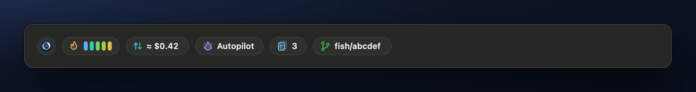
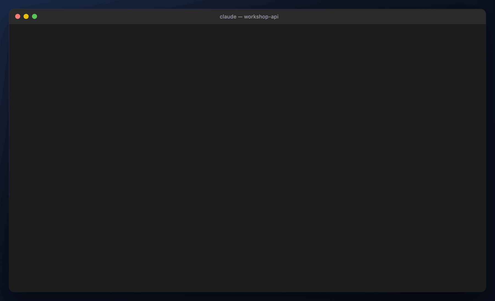
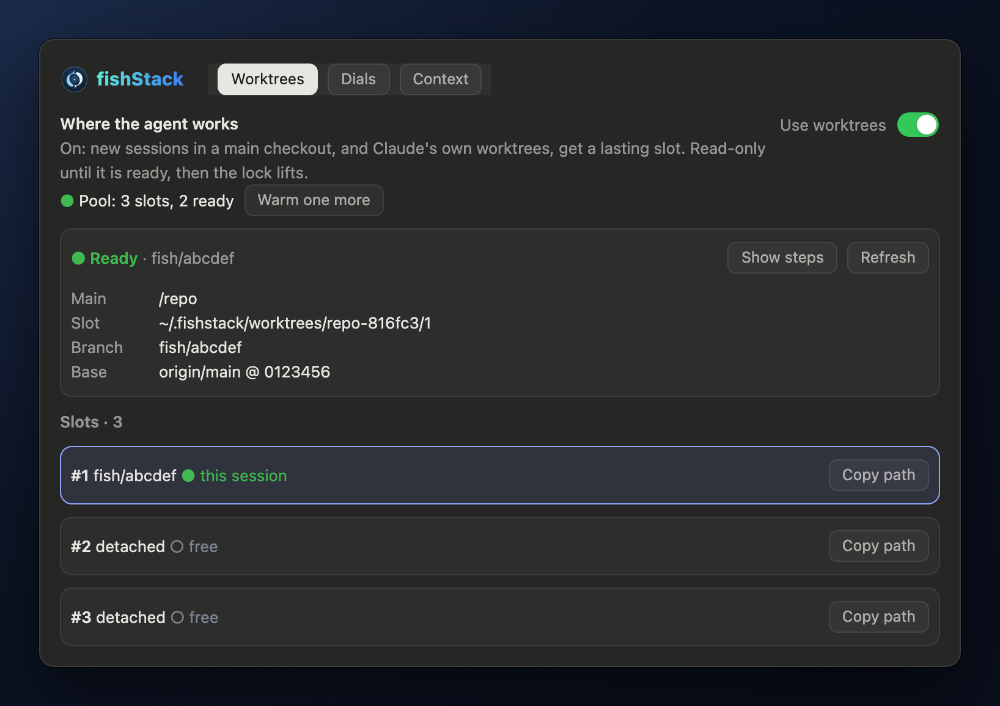
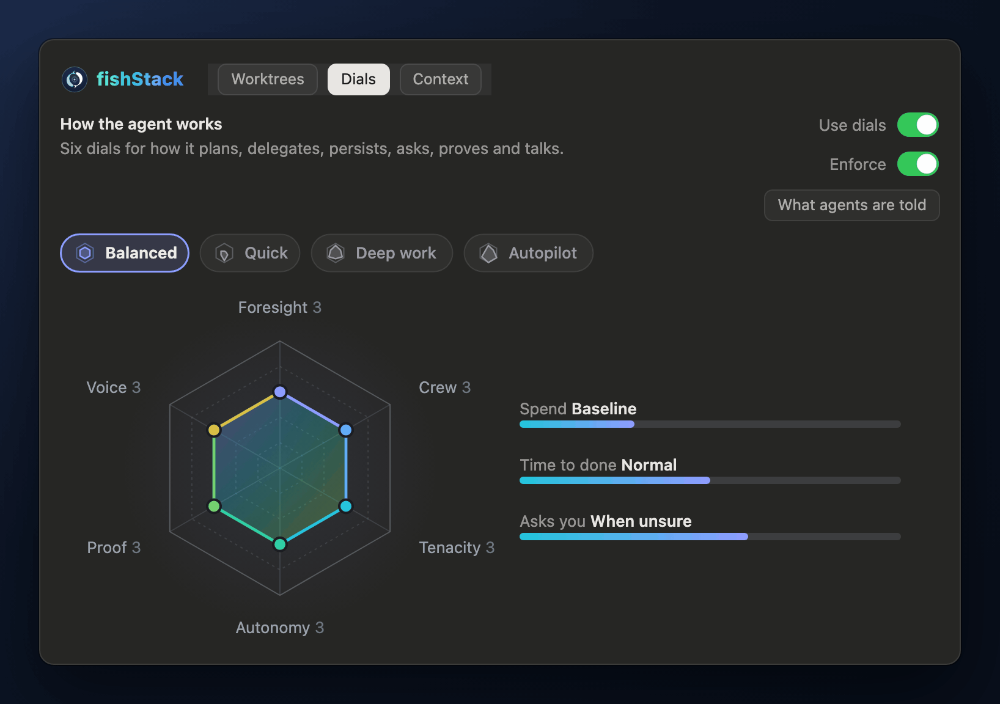
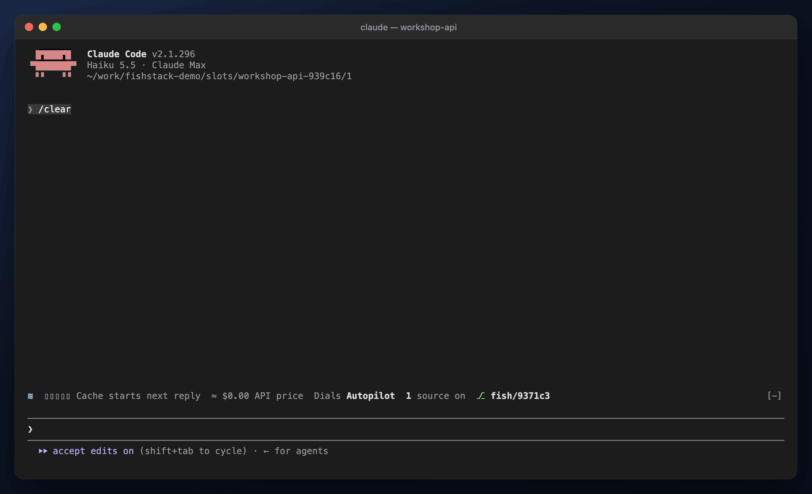
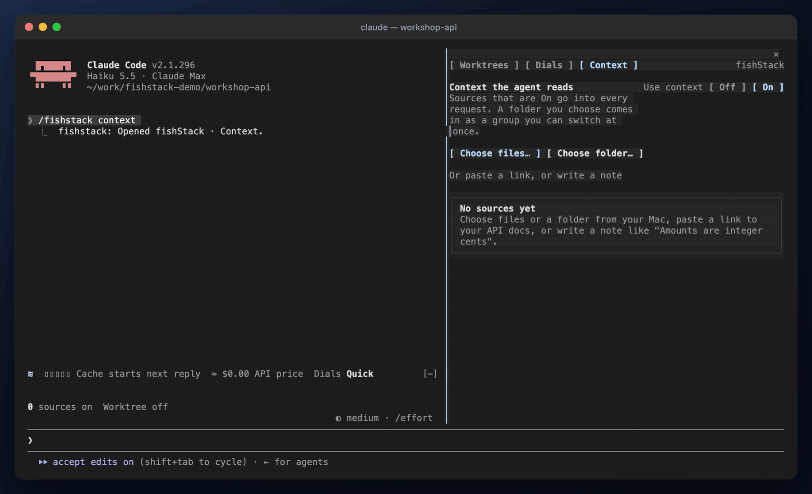
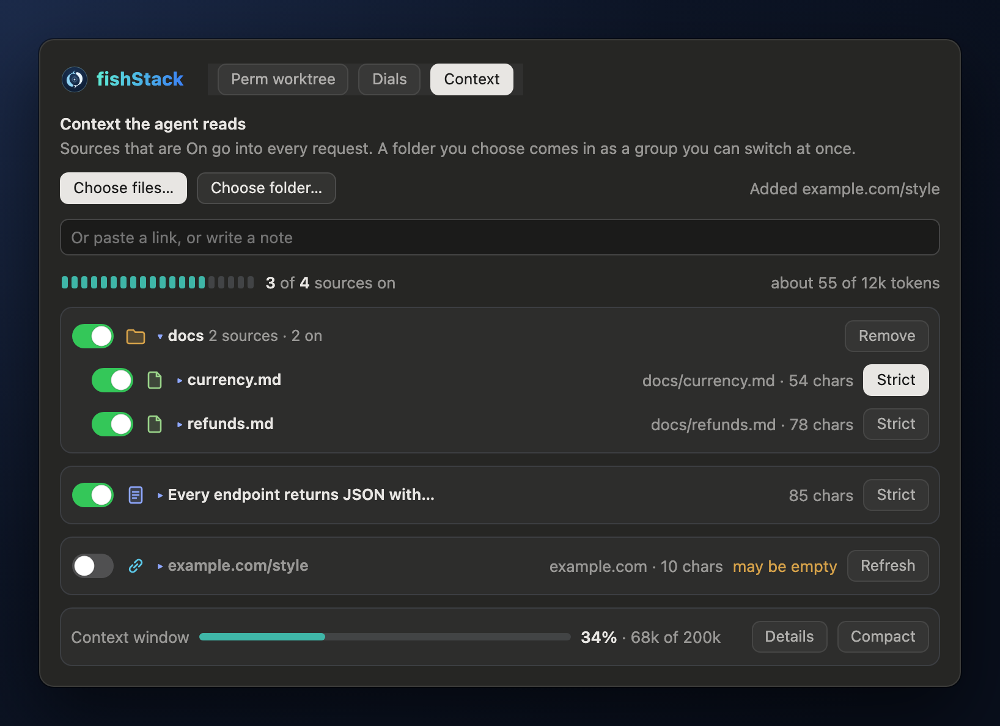

<p align="center">
  
</p>

<h1 align="center">fishStack</h1>

<p align="center">
  <b>A Claude Code plugin: a worktree for every session, a working style you set once,<br>
  and notes the agent always reads.</b>
</p>

<p align="center">
  <a href="https://www.npmjs.com/package/claude-fish-stack-mod"></a>
  <a href="LICENSE"></a>
  
</p>

<p align="center">
  
</p>

If you run Claude Code all day, a few things keep getting in the way:

- **Sessions trip over each other.** Two agents in one checkout edit the same files, and a fresh worktree has no `node_modules`.
- **You keep repeating yourself.** "Write a spec first." "Don't ask, just decide." "Run the tests." You type it every session.
- **The agent forgets what matters.** API conventions, the design doc, the ticket: pasted in again and again.

fishStack adds one pane with three tabs, and a status rail above the prompt. Each tab has a switch at the top (**Use worktrees**, **Use dials**, **Use context**), so you can turn any of them off and the rail shows it.

| Tab | What it does |
| - | - |
| **[Worktrees](#worktrees)** | A new session can move into a worktree of its own, already set up, typically in about three seconds. |
| **[Dials](#dials)** | Six dials set how the agent plans, delegates, persists, asks, proves and talks. Some levels are enforced in code, not only asked for. |
| **[Context](#context)** | Notes, links and files the agent reads in every request. Mark one Strict and the agent treats it as ground truth. |

## Install

In Claude Code 2.1.296 or newer:

```
/plugin marketplace add patrick-lai/claude-fish-stack-mod
/plugin install fishstack@claude-fish-stack-mod
```

Or the same from your shell:

```bash
claude plugin marketplace add patrick-lai/claude-fish-stack-mod
claude plugin install fishstack@claude-fish-stack-mod
```

Or in one step, with no `/plugin` commands:

```bash
npx -y fishstack-mod install
npx -y fishstack-mod uninstall
```

Restart Claude Code, then open the pane with **`/fs`** (or `/fishstack`). `/fs dials` goes straight to a tab. Keys <kbd>1</kbd>–<kbd>3</kbd> switch tabs.

fishStack is built and tested on macOS: copy-on-write cloning and the file pickers use macOS tools.

## Worktrees

<p align="center">
  
</p>

Turn on **Use worktrees** and a new session can have a worktree of its own, on its own `fish/…` branch, kept around to reuse. Your main checkout stays untouched. It is off until you turn it on.

Plain `claude` in a main checkout doesn't say whether you want one, so fishStack asks once at the start:

| Answer | What happens |
| - | - |
| **A worktree** | A branch of its own from the latest origin, read-only for the few seconds until it moves in |
| **This main checkout** | It works right there, on whatever branch is checked out (the dialog names it), with full access |
| **Always a worktree** | A worktree now, and for every new terminal session without asking. **New terminal sessions: Ask each time** in the tab brings the question back |

The pool keeps warming while the question is open, so a worktree is still quick to take, and **Create worktree now** in the tab changes your mind later. Autopilot never answers this question for you. `claude --worktree` is an answer already, so it is not asked.

It's fast because the work happens before you need it:

- **A warm pool.** fishStack keeps a pool of slots in the background (three to start, with one always free), each checked out, with dependencies in place and your setup command already run. A new session takes one and moves in. In the run above that took about three seconds from launch. The tab lists every slot: **+ Add slot** grows the pool, and a new slot shows up straight away as *setting up* with the step it is on, until it's ready. **Remove** (a second press confirms) takes a free slot out, and the pool stays that size from then on (it still keeps one free for the next session).
- **A head start.** While the slot is prepared, the agent can already read, search and plan. Anything that writes waits until it has moved in.
- **No copying.** `node_modules` is cloned copy-on-write (APFS), so a slot costs almost no disk until something changes.
- **Nothing lost.** A slot is reused once its session ends. Anything left uncommitted is saved under `refs/fish/backup/` first.
- **The default branch stays free.** Git lets only one worktree have a branch at a time, so a worktree on `main` (or `master`) locks the main checkout out of its own default branch. Inside a fishStack worktree, the guard refuses `git switch` or `git checkout` onto the default branch and points to `origin/<default>` instead (`git switch -c <branch> origin/main`). A slot that still ends its session on the default branch is detached as it is released.

It works with Claude Code's own worktrees too. `claude --worktree feat-x` lands in a slot on `fish/feat-x`. In the desktop app, its worktree option decides. Ticked, the session stays in the worktree the app made, which fishStack sets up in place (dependencies cloned, `setupCommand` run, read-only until then), so the app's diff, PR and archive keep following it. Unticked, the session stays in the main checkout (**Create worktree now** still claims a slot).

### The desktop app, with no checkout

In a big repository the desktop's own worktree is the slow part: a full checkout for every session, and it refuses to make one at all with less free disk than 2.5 times the repository's git pack. Give the desktop the pool's slots instead. Its `WorktreeCreate` hook then takes the slot fishStack keeps offered (clean, detached, dependencies in place), holds it for the session, checks out the session's branch from origin and hands it over. The desktop tracks that slot as the session's worktree, so its diff, PR and archive follow it. When the desktop removes the worktree, the hold goes and the slot returns to the pool. With no slot offered, the hook makes a new one, as slow as the desktop's own.

It sets itself up. The first session in a repository with **Use worktrees** on keeps the hook beside the repository's git data (`.git/fishstack/`) and wires it into the repository's `.claude/settings.local.json`, your own settings for it, kept out of git (added to the repository's local `info/exclude` if nothing ignores it). Everything else in that file stays, a toast says it happened, and turning **Use worktrees** off takes fishStack's entries out again. A file that doesn't parse, or a `WorktreeCreate` hook of your own there, is left alone.

Every Claude Code client in the repository reads those settings, so the hook decides at each call who it is for:

| Caller | Gets |
| - | - |
| The desktop app, fishStack enabled, **Use worktrees** on | A slot from the pool |
| The CLI with fishStack | A slot: fishStack answers its worktree creation itself, before the hook (plain `claude` asks first) |
| Anything else: ACP, the SDK, the CLI without fishStack | The worktree Claude Code makes itself, `.claude/worktrees/<name>` on `worktree-<name>` from origin's default branch |
| Any client once fishStack is disabled or **Use worktrees** is off | Claude Code's own worktree, and the hook takes its entries out of the settings |

The desktop runs the hook only for a session a person starts, so a fork or a session Claude starts in that repository gets no worktree. A hook replaces `.worktreeinclude`, so those files aren't copied. `e2e/desktop-hook.sh` checks the hook against a throwaway repository.

<p align="center">
  
</p>

<details>
<summary><b>How a slot is made</b></summary>

1. **Fetch.** `git fetch origin <default>`. If that fails, it starts from the local branch and says so.
2. **Claim.** Under a per-repository lock (an atomic `mkdir`, broken after 30 s if its holder died), it takes the slot this session already holds (a retry), an idle slot, or makes the next one. A new slot is `git worktree add --detach --no-checkout`, then `reset --hard` with `core.checkStat=minimal`, then an index warm-up. A used slot is scrubbed: uncommitted work goes to `refs/fish/backup/<slot>-<time>`, then `reset --hard`, `clean -fd` (ignored files such as `node_modules` stay) and `checkout -B fish/<name>`. The name is the session's id, or the Claude Code worktree it was adopted from; if a branch by that name already exists (Claude Code reuses a worktree folder for a new session), the slot gets `fish/<name>-<session id>` instead, so no other session's branch is ever reset. Git hooks never run on these writes.
3. **Seed.** Each missing `node_modules` (up to six folders deep) is cloned with `cp -c` into a staging folder, then renamed into place. The source is an idle sibling slot with the same lockfiles, or else the main checkout. Then `setupCommand` runs, unless this slot already ran it with these lockfiles.
4. **Move in.** The session enters the slot (`EnterWorktree`) as soon as it is ready, even mid-turn. The agent always knows where it is: a head start that began after the prompt (an app attaching late) is told after its next tool call, and so is a move it was not warned of. Slots live under the repository's `.claude/worktrees/`, where Claude Code keeps its own, so the move needs no confirming. Set `worktreeRoot` elsewhere and Claude Code asks you to confirm each move.

A slot being made is marked in the store, so every session lists it as setting up and none claims it half made. Removing a slot leases it first, saves anything uncommitted under `refs/fish/backup/`, then moves it out of the pool and deletes it; its branch stays. The pool stops warming when free disk drops under `minFreeGb` (20 GB), and the tab says why. During the head start, the guard refuses Edit, Write, MultiEdit, NotebookEdit and ExitPlanMode. It also refuses any shell command that is not a known read (`ls`, `cat`, `rg`, read-only `git`, `sed -n` and the like). A redirect anywhere but `/dev/null` counts as a write.
</details>

## Dials

<p align="center">
  
</p>

Six dials, each with five levels, become a short **Working style** brief in the agent's system prompt:

| Dial | 1 | 2 · 3 · 4 | 5 |
| - | - | - | - |
| **Foresight** | Dive in | Sketch · Plan steps · Write a spec | Deep spec |
| **Crew** | Solo | Scouts · Helpers · Squads | Swarm |
| **Tenacity** | One pass | Retry once · Push through · Checklist | Goal mode |
| **Autonomy** | Ask first | Check in · When unsure · Decide, note | Autopilot |
| **Proof** | Trust | Compile · Run tests · Component QA | Full QA |
| **Voice** | Silent | Terse · Normal · Explain | Teach |

Start from a preset (**Balanced**, **Quick**, **Deep work**, **Autopilot**), then nudge single dials. On the desktop you can drag the radar's points. The estimates beside the radar show what a setting costs you in spend, time to done, and how often the agent will ask you.

A change takes effect right away, even mid-turn: the agent picks it up before its next request. **What agents are told** shows the exact brief. **Use dials** off sends no working style at all, and your settings wait for you.

### Enforced, not only asked

A prompt is a request; some levels are also held in code, so the agent can't skip them. Each dial's card says what its level enforces:

| Dial | Level | Enforced |
| - | - | - |
| Foresight | Write a spec, Deep spec | The first edit of a request waits until the agent has posted its spec. |
| Crew | Solo, Scouts | Subagents are refused; at Scouts, one per request. |
| Tenacity | Checklist, Goal mode | A request that changed code ends with its checklist or acceptance criteria. |
| Proof | Compile and up | A request that changed code runs a build, typecheck or tests after its last change. |
| Voice | Explain, Teach | A request that changed code ends with the labelled parts. |
| Autonomy | Autopilot | A question nobody answers is settled after 15 minutes. |

It's built never to get in the way of Claude Code itself:
- **Capped.** An edit is refused twice at most per request, then let through, and the end of a request is held back once at most, never in a loop.
- **Main agent only.** Subagents and doc-only changes are left alone.
- **Fails open.** Any check that can't decide lets things through.
- **Switchable.** The **Enforce** switch turns it all off and leaves the dials as prompts alone.

The level prompts borrow good habits from [pStack](https://github.com/cursor/plugins/tree/main/pstack) (Lauren Tan, MIT): verdicts of VERIFIED, NOT VERIFIED or INCONCLUSIVE, a failing test before a bug fix, one done-predicate and one owner per file for parallel subagents, and testing a shared assumption after two failed fixes.

### Autopilot answers when you're away

<p align="center">
  
</p>

Autopilot is the top Autonomy level: the agent works as if you're away. It decides open questions itself, clears its own blockers, may use other apps and connected tools, and never deletes data.

If it still asks you something and nobody answers, the question isn't left hanging overnight. After 15 minutes (`autoAnswerMinutes`), Autopilot picks the option marked *(Recommended)*, or the first one. The agent is told that no person chose, and carries on.

While Autopilot waits, the dials pill on the rail turns amber with a ring that runs down, and its tooltip says what it will pick. Once it has answered, the pill turns green with a check until you type again. Answer yourself, or lower the dial, and nothing is picked.

## Context

<p align="center">
  
</p>

Add the things the agent should always know (**Use context** off holds them all back at once): a note, a link (fetched as text), a file, or a whole folder from **Choose folder…**. Each source has an **On/Off** switch. A **Strict** source is binding: if the code disagrees, the agent has to say so. A meter keeps the total near a 12k-token budget, and a footer shows how full the context window is.

Libraries are kept per repository and reach the agent as a **Project context** section, every request.

<p align="center">
  
</p>

## The rail

The rail is one row of pills above the prompt, and it stays one row at any window width. In the desktop app, hover a pill for details (nothing shifts) and click it to open its tab.

| Pill | Shows |
| - | - |
| **Mark** | Opens fishStack. |
| **Cache** | The prompt cache. Five bars run down over the five minutes after a reply. While any are lit, your next message reuses the cache, so it's faster and cheaper. Hover for the hit rate: the last reply's and the whole session's share of input read from the cache, from the token counts Claude reports. |
| **Cost** | Claude Code's own `/cost` total at API list prices, cache reads and writes included. It isn't your plan's bill. Tokens in and out on hover. |
| **Dials** | The preset, or Off. Amber while Autopilot waits to answer for you, green once it has. |
| **Context** | How many sources are on, or Off. |
| **Worktree** | The branch this session works on. |

In the terminal the rail is plain text, and the same items open the same tabs.

## Options

Set them in `/config`. They're stored under `pluginConfigs["fishstack"].options`.

| Option | Default | What it does |
| - | - | - |
| `autoWorktree` | `false` | Use worktrees' starting value. Once you flip the switch, your choice sticks. |
| `worktreeRoot` | empty | Where slots live. Empty: `<repo>/.claude/worktrees/fishstack/<n>`, added to the repository's local `info/exclude` if nothing ignores it yet. Set: `<root>/<repo>-<hash>/<n>`, and Claude Code asks before each move in. |
| `setupCommand` | empty | Runs in a new slot before the session moves in, `pnpm install` say. Times out after 10 minutes. |
| `minFreeGb` | `20` | The pool stops warming below this much free disk. |
| `autoAnswerMinutes` | `15` | How long Autopilot waits before answering for you. |

<details>
<summary><b>Coming from Craftshop?</b></summary>

fishStack was called Craftshop. Its first session copies what Craftshop saved (dials, context libraries, the worktrees switch) into its own store, once, and never over anything fishStack already holds. Options set under `pluginConfigs["craft-shop"]` don't carry over, so set them again in `/config`.
</details>

## Develop

```bash
claude plugin test .
```

That runs the tests in `tests/`, drawing the UI on both the terminal and the desktop. More:

```sh
claude plugin validate .      # manifest, marketplace and hooks module
claude --plugin-dir .         # run it; saving hot-reloads
e2e/drive.sh                  # end to end against real Claude Code in tmux
e2e/shoot.sh                  # every desktop tab, screenshotted
e2e/reel/scenes.sh            # record this README's terminal scenes from real Claude Code
e2e/reel/media.sh             # draw every picture in docs/media
```

`e2e/drive.sh` checks every feature as a person would, against a fixture repository: the pool warms, a session claims a slot and its writes land there, the next session reuses it with a backup, dials (mid-turn too) and a Strict note reach the agent, Autopilot answers an unanswered question, and `claude --worktree` comes up in a slot.

The README's media come from two places:

- **Terminal GIFs** (`claim`, `autopilot`, `context`): real Claude Code with this plugin, recorded in tmux by `e2e/reel/scenes.sh`.
- **Desktop pictures** (`rail`, `dials`, the two panes): the desktop's own UI trees, drawn by the tests in `tests/media.test.ts` and `tests/desktop.test.ts` and laid out as the desktop pane. These are close to the app's own paint, not screenshots of it.

## The mark

"Moonlit": two pale koi circling a ripple on night water, a school of two. It's drawn in code in `hooks/brand.ts`, and `node e2e/brand.mjs` writes [`assets/icon.svg`](assets/icon.svg) and a one-colour menu-bar version, [`assets/icon-template.svg`](assets/icon-template.svg).

## License

[MIT](LICENSE) © Patrick Lai
