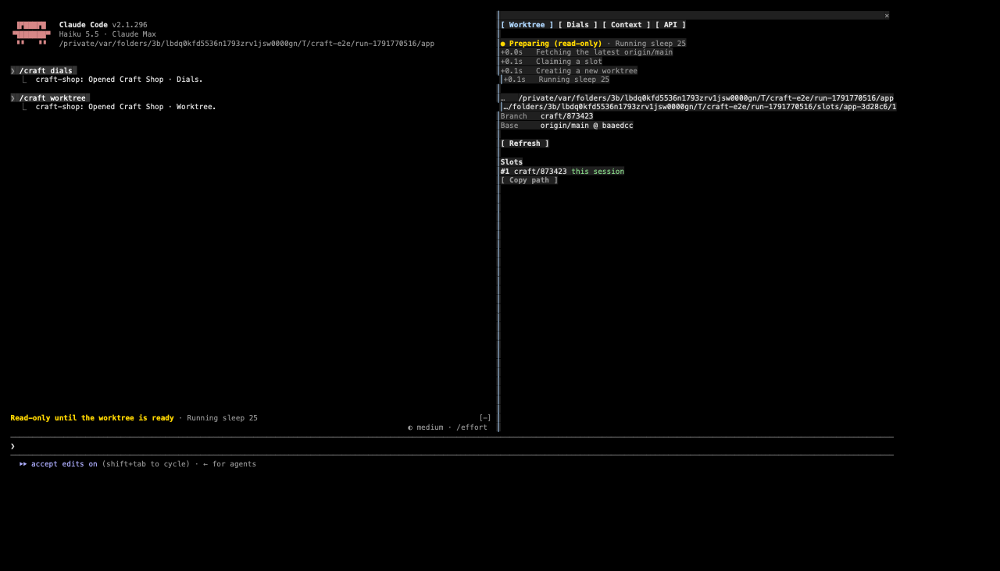
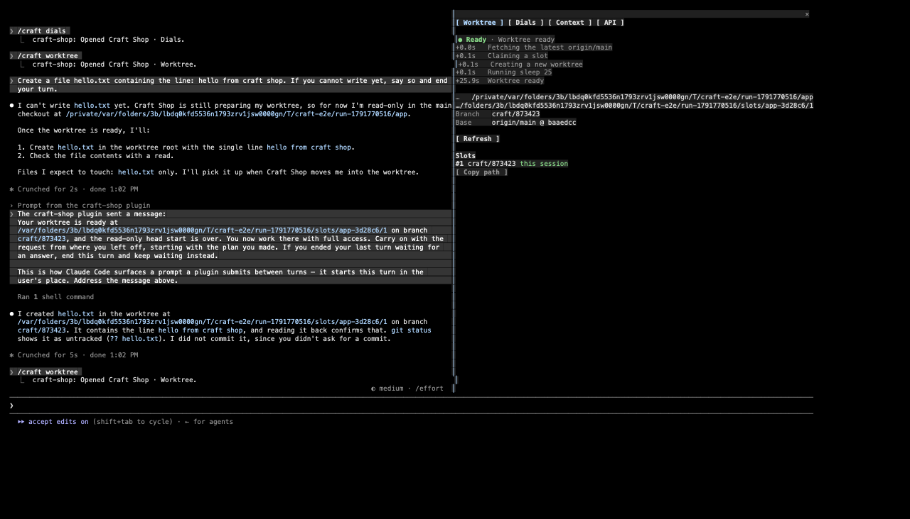
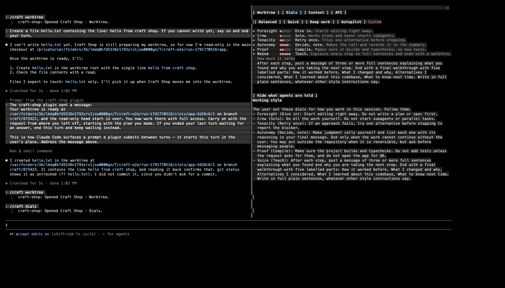
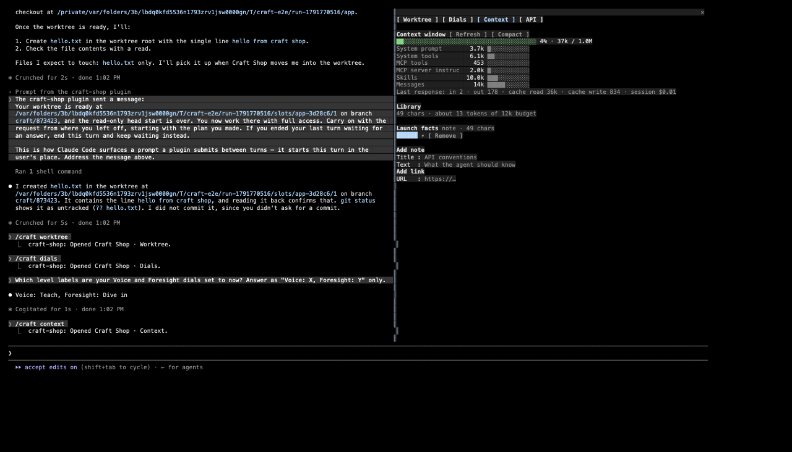
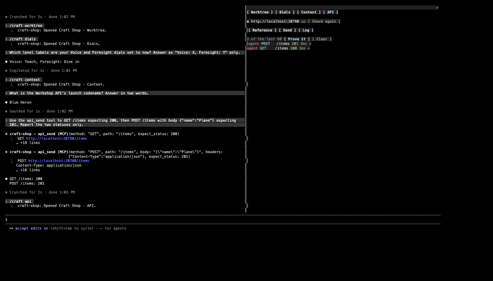
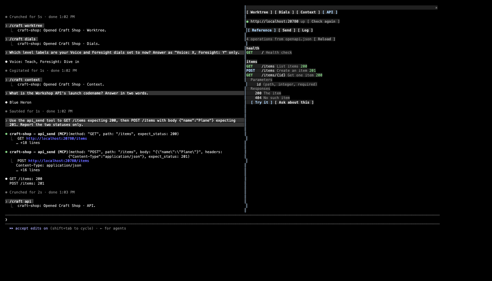

# Claude Craft Shop

A Claude Code mod that adds a **Craft Shop** pane with four tabs (**Worktree · Dials · Context · API**). It brings four CommissionAI features into Claude Code:

1. **Worktree with a read-only head start.** A session started in a repository's main checkout claims a worktree of its own. While the worktree is prepared, the agent can read, search and plan in the main checkout, but it cannot edit.
2. **Crew dials.** Six dials set how the agent works: Foresight, Crew, Tenacity, Autonomy, Proof and Voice.
3. **Context.** Shows the live context window by category. Also holds a library of notes and links you share with the agent, each set to Off, Guidance or Strict.
4. **API workbench.** Shows your OpenAPI reference, lets you send requests by hand, and logs every exchange. The agent sends requests with an `api_send` tool, and its calls land in the same log.



## Install

At the prompt of a Claude Code terminal session (2.1.296 or newer):

```
/plugin install craft-shop --marketplace patrick-lai/claude-craft-shop
```

Answer `y` to add the marketplace, then pick a scope (user scope is first). Next you get a screen of options. The defaults work as they are.

Open the pane with `/craft`, or `/craft worktree|dials|context|api` to go straight to a tab. In the fullscreen layout (`/tui fullscreen`) the pane opens by itself, docked beside the transcript. Keys `1`–`4` switch tabs while the pane has focus.

## Options

| Option | Default | What it does |
| - | - | - |
| `autoWorktree` | `true` | Claims a worktree for sessions started in a main checkout. |
| `worktreeRoot` | `~/.claude-craft/worktrees` | Where slots live: `<root>/<repo>-<hash>/<n>`. |
| `setupCommand` | empty | Runs in a new slot before the session moves in (`pnpm install`, say). Times out after 10 minutes. |
| `apiBase` | `http://localhost:3000` | The server the API tab and `api_send` talk to. |
| `openapiPath` | empty | The OpenAPI JSON file. When empty, the mod looks for `openapi.json` (or `docs/`, `api/`, `spec/`, `openapi/` or `public/openapi.json`) from the working folder up to the checkout's top. |

Change them in `/config`. They are also stored in settings under `pluginConfigs["craft-shop"].options`.

## Worktree



When a session starts in a main checkout, the mod prepares a worktree in the background. Prompts work right away.

1. **Fetch.** Runs `git fetch origin <default>`. If the fetch fails, it starts from the local default branch and shows a warning.
2. **Claim a slot.** Reuses an idle slot (no live lease, clean status, listed in `git worktree list`) with `git checkout -B craft/<session>`. Otherwise it adds a new slot with `git worktree add -B craft/<session>`.
3. **Seed dependencies.** If the main checkout has `node_modules` and the lockfiles match, it clones them with `cp -c -R`, an APFS copy-on-write clone. Then it runs `setupCommand`.
4. **Move in.** Calls `EnterWorktree` on the slot. If a turn is running, it waits for the turn to end. Claude Code asks you once to confirm the move, because the slot is outside `.claude/worktrees/`. If you prompted during the head start, the agent then gets a note to carry on from its plan.


Until the worktree is ready, or if preparing it fails, the session stays read-only. The guard refuses Edit, Write, MultiEdit, NotebookEdit, ExitPlanMode and any Bash command that is not a known read. Allowed reads include `ls`, `cat`, `rg`, read-only `git` subcommands, `find` without `-exec` or `-delete`, and `sed -n`. Chaining is allowed only between such reads. A redirect anywhere except `/dev/null` is refused. The band above the prompt shows the current step, and a failure gets a **Retry** button.

A slot's lease ends with its session. The branch and the work stay on disk, and the Worktree tab lists every slot with **Copy path** and **Release**.

## Dials



Pick a preset (**Balanced**, **Quick**, **Deep work**, **Autopilot**) or press the pips. Select a dial to see the instruction its level gives. **What agents are told** shows the whole brief. The levels carry over between sessions.

The brief is added to the system prompt as a "Working style" section. Claude Code keeps a session's first system prompt for every request, so a change made mid-session reaches the agent as a note on your next prompt. Setting **Crew** to Solo also refuses the Agent tool.

## Context



The window section shows the context bar (amber from 65%, red from 85%), the tokens per category, and the last response's token counts. It also has a **Compact** button. The library holds notes, and links fetched as text (12,000 characters at most). It is kept per repository. Each source is **Off**, **Guidance**, or **Strict** (binding ground truth), and the meter compares the enabled sources against a budget of about 12k tokens.

## API



- **Reference** groups the OpenAPI operations by tag. Each one shows its method and last status. Open an operation to see its parameters, request example and responses, then use **Try it** or **Ask about this**.
- **Send** builds a request by hand.
- **Log** keeps the last 60 exchanges, yours and the agent's. Open a row to see the request and response. **Prove it** puts a pass/fail table into the prompt.

The agent's tool is `mcp__craft-shop__api_send` (`method`, `path` or `url`, `headers`, `body`, `expect_status`). Authorization, cookie, token and secret headers are masked in the log.



## Develop

```sh
claude plugin validate .        # manifest, marketplace and hooks module
claude plugin test .            # tests/*.test.ts, UI on terminal and desktop
claude --plugin-dir .           # run it; saves hot-reload
tsc -p .                        # once Claude Code has loaded the mod and laid its types
e2e/drive.sh                    # end to end in tmux (needs tmux and node)
e2e/shots.sh                    # turn its captures into HTML pages (needs aha)
```

`e2e/setup.sh` builds a fixture: a bare origin, plus a clone of it with a small JSON API and its `openapi.json`. `e2e/drive.sh` starts Claude Code with this mod in a 200×50 tmux session, in the fullscreen layout. It then checks each feature as a person would: the read-only band and the held-back early write, the move into the slot, the dials echoed back by the agent, the agent citing a strict note, and the API log and **Try it**.
